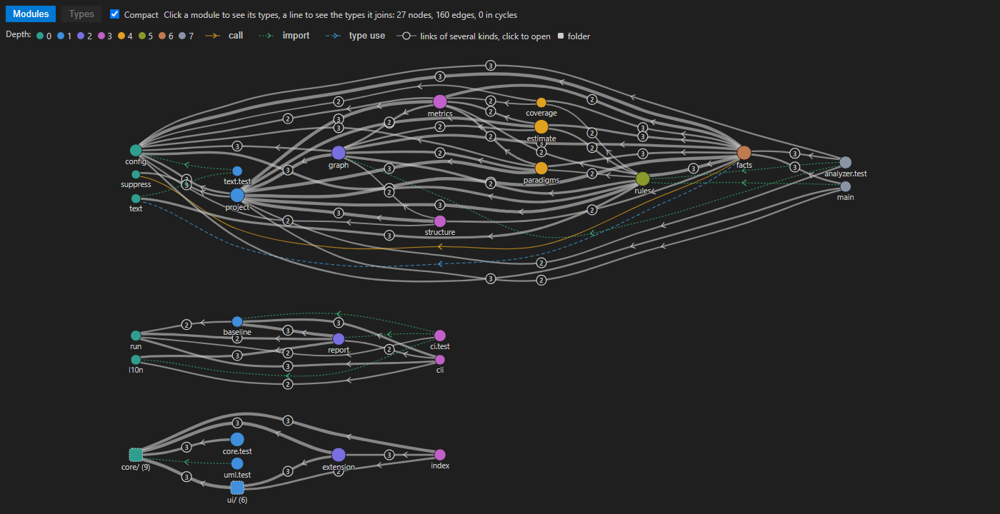
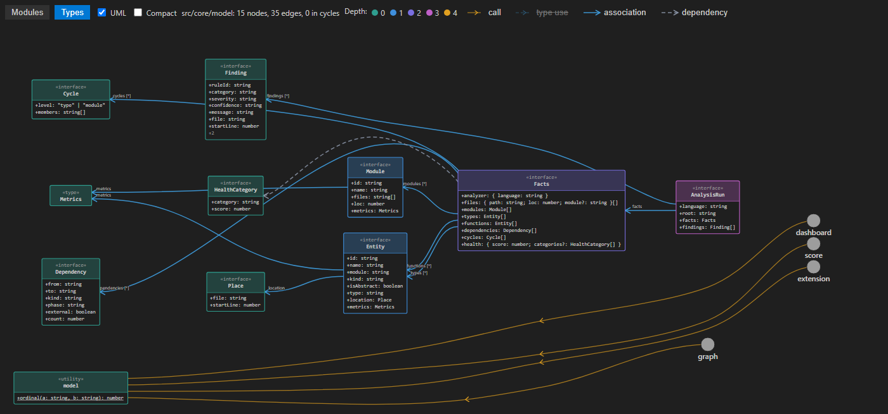
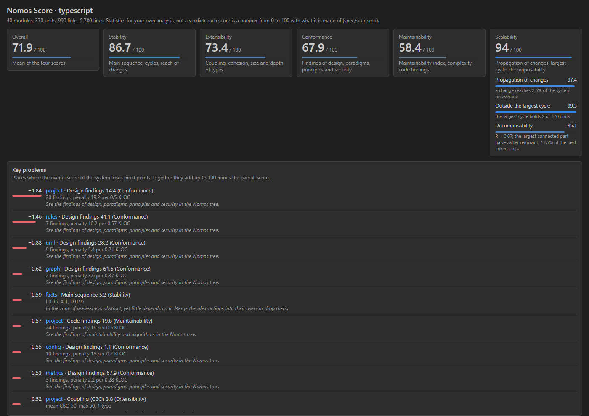

# Nomos

**Статический осмотр кода: статистика и наблюдения без вердиктов.**

Зависимости, метрики, сложность алгоритмов, парадигмы, паттерны, чистота кода и базовая безопасность — для **C#, Go, TypeScript, JavaScript, Python, Java, Kotlin и Ruby**.

Все выводы — эвристики. У каждой находки есть уровень уверенности и объяснение, почему она появилась. Nomos показывает статистику для анализа разработчиком: порогов приёмки, оценок и кодов возврата от числа находок нет.



## Расширения VS Code

| Расширение | Что делает |
|---|---|
| [**Nomos**](https://marketplace.visualstudio.com/items?itemName=honestarchitector.nomos) | Ядро: находки, метрики над кодом, граф зависимостей, диаграммы классов, парадигмы, русский интерфейс |
| **Nomos: C#**, **Go**, **TypeScript and JavaScript**, **Python**, **Java**, **Kotlin**, **Ruby** | Языковые пакеты: по анализатору на язык. Ядро само предложит нужный пакет |
| [**Nomos Score**](https://marketplace.visualstudio.com/items?itemName=honestarchitector.nomos-score) | Баллы от 0 до 100 с разбором и панели системы и модуля |
| [**Nomos Agents**](https://marketplace.visualstudio.com/items?itemName=honestarchitector.nomos-agents) (preview) | ИИ-агенты проверки парадигм и практик и скорости функций, MCP-сервер |

<table>
<tr>
<td width="50%"><br><sub>Диаграмма классов модуля</sub></td>
<td width="50%"><br><sub>Nomos Score: баллы и ключевые проблемы</sub></td>
</tr>
</table>

## Состав

Поставка тремя частями (D-056, D-062):

- **Ядро** — расширение VS Code в `extension/`: дерево, граф, диаграмма классов, находки, настройки, русский интерфейс. Языков не знает.
- **Каталог правил** — `rules.json` и `practices.json`, собираются из `spec/`. Едут в составе ядра.
- **Языковые анализаторы** — `analyzers/<язык>/`, каждый на родных инструментах языка. Поставляются отдельными пакетами: `nomos-csharp`, `nomos-go`, `nomos-typescript` (TypeScript и JavaScript), `nomos-python`, `nomos-java`, `nomos-kotlin`, `nomos-ruby`.

Общие `contracts/` (форматы данных), `spec/` (формулы, правила, парадигмы) и `conformance/` (эталонные случаи, которые проходит каждый анализатор) — один закон для всех языков.

Рядом — `score/` (Nomos Score, D-065), `agents/` (Nomos Agents и MCP-сервер, D-063) и `ci/` (`nomos-ci` для конвейеров).

### Документация

| | |
|---|---|
| [Архитектура](docs/ARCHITECTURE.md) | как устроены ядро, анализаторы и контракты |
| [Как добавить язык](docs/EXTENDING.md) | новый анализатор от манифеста до пакета |
| [Каталог правил](docs/ANALYZERS.md) | все правила и практики, генерируется из `spec/` |
| [Перевод](docs/TRANSLATING.md) | как добавить язык интерфейса |
| [Журнал решений](docs/DECISIONS.md) | список решений, сами решения — в [docs/decisions](docs/decisions/) |
| [Порядок работ](docs/ROADMAP.md) | этапы, сделанное — в [roadmap-done](docs/roadmap-done.md) |

## Сборка и проверка

Расширение и пакеты собираются из `extension/`:

```powershell
cd extension
npm install
npm test                                # ядро без VS Code
npm run check-boundary                  # в ядре нет языко-специфичного кода
npm run package -- --target win32-x64   # dist/: ядро и языковые пакеты
```

Анализатор C# (нужен .NET SDK 10):

```powershell
cd analyzers/csharp
dotnet build Nomos.slnx
dotnet test Nomos.slnx
dotnet run --project src/Nomos.Analyzer.CSharp -- manifest
dotnet run --project src/Nomos.Analyzer.CSharp -- analyze --root tests/fixtures/golden/sample-project --sarif nomos.sarif > facts.json
```

Facts печатаются в stdout, находки пишутся в файл SARIF.

Conformance — все анализаторы на одних и тех же случаях:

```powershell
cd conformance/runner
npm install
npm run all
```

Подробнее о harness и его командах — [conformance/README.md](conformance/README.md).

## Протокол анализатора

```
nomos-<язык> manifest
nomos-<язык> analyze --root <путь> [--sarif <файл>] [--config <nomos.json>] [--rules <id,id>]
```

| Код выхода | Значение |
|---|---|
| 0 | успех |
| 1 | непредвиденная ошибка |
| 2 | ошибка использования |
| 3 | входные данные не годятся |
| 4 | частичный результат |

Число находок и балл на код выхода не влияют.

## Лицензия

[MIT](LICENSE). Издатель в Marketplace — `honestarchitector`.
