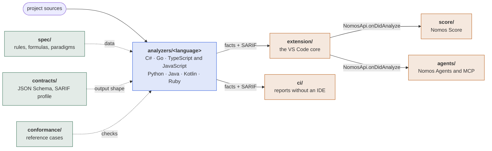

# Nomos architecture

**English** · [Русский](ARCHITECTURE.ru.md)

Nomos is made of independent **analyzers** (one per language), shared **contracts** and a **VS Code extension** that only shows the result. There is no single core that parses every language (D-020).

Nomos gives statistics and observations for a developer to read. There are no acceptance thresholds, no pass or fail grades and no verdicts; findings are heuristics with a confidence level and an explanation.

## Overview



Green is the law shared by all languages, blue the analyzers, orange what only shows the result. The only links between the parts are the files in `contracts/` and the text in `spec/`. The extension does not know how an analyzer works; an analyzer does not know about the extension. Score and Agents get the result from the core and never look into the analyzers. Each part is described below: [contracts](#contracts), [rules and metrics](#rules-and-metrics), [conformance](../conformance/README.md), [running without an IDE](#running-without-an-ide), [the extension](#the-vs-code-extension).

### Analyzers

Each analyzer is a standalone program built on its language's own tools.

| Language | Folder | Parsing | Runs as | Decision |
|---|---|---|---|---|
| C# | `analyzers/csharp` | Roslyn | `src/Nomos.Analyzer.CSharp` (`nomos-csharp`) on .NET 10 | D-031 |
| Go | `analyzers/go` | `go/parser`, `go/types` | `cmd/nomos-go`, a binary per platform | D-038 |
| TypeScript, JavaScript | `analyzers/typescript` | TypeScript Compiler API | `src/main.ts` on VS Code's own Node; `--language javascript` picks the language | D-055 |
| Python | `analyzers/python` | `ast`, `tokenize` | `main.py` on the user's interpreter, `python -I`, 3.10+ | D-057 |
| Java | `analyzers/java` | javac Tree API (`jdk.compiler`) | `run.mjs` on the user's JDK 17+ | D-058 |
| Kotlin | `analyzers/kotlin` | PSI from `kotlin-compiler-embeddable` | `run.mjs` on Java 17+; the compiler is pinned in `deps.json` and fetched by `run.mjs --fetch` | D-059 |
| Ruby | `analyzers/ruby` | Prism from the standard library | `main.rb` on the user's interpreter, Ruby 3.3+ | D-061 |

No analyzer depends on anything beyond its language's standard tools, except for the `typescript` compiler and the Kotlin compiler.

## Contracts

Each file in `contracts/` has an `$id` with a version and an `x-contractVersion` field. Each document an analyzer prints has a `schemaVersion`; the extension rejects documents of an unknown major version with a clear message.

| Contract | File | Produced by | Read by |
|---|---|---|---|
| Manifest | `manifest.schema.json` | the analyzer, `manifest` command | the extension, the harness |
| Facts | `facts.schema.json` | the analyzer, `analyze` command | the extension (graph, metrics, tree), the harness |
| Check results | SARIF 2.1.0 + `sarif-profile.md` | the analyzer, `analyze --sarif` | the extension (Diagnostics, tree), CI, GitHub Code Scanning |
| Rule | `rule.schema.json` | rule authors | the harness, the documentation generator |
| Practice | `practice.schema.json` (`spec/practices.yaml`) | rule authors | analyzers, the extension (through `npm run spec-json`), the harness |
| Workspace | `nomos.schema.json` | the user; the extension writes `practices` on command and its own file when there is no `nomos.json` | analyzers, the extension, the CI run |
| Conformance case | `conformance-case.schema.json` | case authors | the harness |

Rules of change:

- a version changes by an explicit increase of `schemaVersion` and a decision in `docs/decisions/`;
- adding an optional field is a minor version, anything else is major;
- a new analyzer does not change existing contracts without a discussion.

### What facts hold

Facts are measurements and observations, without verdicts:

- `files`: paths (relative to `--root`, forward slashes), lines, `loc`;
- `modules`, `types`, `functions` with stable identifiers (the language's native qualified name) and the metrics of `spec/metrics.md`;
- `dependencies`: `from`, `to`, `kind` (`import`, `inheritance`, `call`, `type-ref`), `phase` (`runtime` or `type-only`), the `external`/`stdlib` flags;
- `cycles` (Tarjan), `health` (a number and how it was reached, not a grade);
- `paradigmEvidence` for each module;
- `skippedRules`: which rule was not applied, to which module, and why;
- `diagnostics`: warnings and errors of the analysis.

Check results are not repeated in facts: they are only in SARIF.

## Analyzer protocol

An analyzer is a standalone program. The extension and CI call it the same way:

| Command | Result |
|---|---|
| `<analyzer> manifest` | the manifest on stdout |
| `<analyzer> analyze --root <path> [--files <list>] [--sarif <file>]` | facts on stdout; with `--sarif` the check results go to the file, whose path is in `checks.sarifFile` |

`--files` is a list of paths relative to `--root`, one per line in a file `@list.txt` or comma-separated arguments. An analyzer without partial analysis (`capabilities.partialAnalysis = false`) ignores `--files` and analyzes everything; the client takes this into account. All current analyzers work this way, and the clients always analyze the whole root: graphs, Ca, Ce and cycles over part of the files are wrong (D-040).

Further options shared by all: `--config <nomos.json>` (the workspace file, `contracts/nomos.schema.json`) and `--rules <comma-separated ids>`. Without options, behavior follows the manifest and the defaults of `spec/rules`. An analyzer must work without `--config`: that is how the extension runs it in a folder without `nomos.json`.

The output is deterministic: no time, no absolute paths, no random identifiers; arrays are in Ordinal order. Two runs on the same input are byte for byte equal.

### Exit codes

| Code | Meaning | On stdout |
|---|---|---|
| 0 | success; the number of findings does not affect the code | facts |
| 1 | an unexpected error in the analyzer | nothing, details on stderr |
| 2 | a usage error: unknown command or option | nothing |
| 3 | the input is not usable: `--root` does not exist, no files of the language | nothing |
| 4 | a partial result: some files were not parsed | valid facts, the files with `parsed: false`, the reasons in `diagnostics` |

Errors and warnings for people go to stderr. A client reads stderr only to show it; everything for machines is on stdout and in the SARIF file.

## How the extension finds analyzers

`nomos.json` at the workspace root (`contracts/nomos.schema.json`):

```json
{
  "schemaVersion": "1.0.0",
  "analyzers": [
    { "language": "csharp", "command": ["dotnet", "run", "--project", "analyzers/csharp/src/Nomos.Analyzer.CSharp", "-v", "q", "--"] }
  ]
}
```

The extension runs `command + ["manifest"]`, checks the answer against the schema and remembers the capabilities. For analysis it adds `analyze --root ... --sarif ...`. The extension knows nothing about how an analyzer works inside and has no language-specific logic.

### Without `nomos.json`: bundled analyzers

The published extension carries the analyzers with it (D-046), in language packs (D-056, D-062). A package is built per platform (`npm run package -- --target win32-x64` in `extension/`); the builds of the analyzers go to `bundle/`, together with the registry `bundle/analyzers.json`:

```json
{ "analyzers": [
  { "language": "go", "files": ["**/*.go"], "command": ["${bundle}/go/nomos-go.exe"] },
  { "language": "javascript", "files": ["**/*.js", "..."], "command": ["${node}", "${bundle}/typescript/main.js", "--language", "javascript"] },
  { "language": "csharp", "files": ["**/*.cs"], "command": ["${runtime}", "${bundle}/csharp/nomos-csharp.dll"],
    "runtime": { "name": "...", "extension": "ms-dotnettools.vscode-dotnet-runtime", "command": "dotnet.acquire", "argument": { "version": "10.0" }, "resultField": "dotnetPath" } },
  { "language": "python", "files": ["**/*.py"], "command": ["${runtime}", "-I", "${bundle}/python/main.py"],
    "runtime": { "name": "...", "extension": "ms-python.python", "command": "python.interpreterPath", "argument": { "workspaceFolder": "${folder}" },
                 "path": ["python3", "python", "py"], "check": ["-I", "-c", "..."], "installUrl": "https://www.python.org/downloads/" } }
] }
```

The build script writes the registry and takes `files` from the analyzer's manifest (the `files` field, contract 1.2.0). In a folder without `nomos.json`, the extension runs the analyzers that match at least one file by `files`, without `--config`, with default settings. Settings come from the VS Code workspace settings (D-050): when `nomos.practices` is set, the extension writes a workspace file with the analyzer's command and `practices` into its own storage (`workspaces/<folder>-<language>.json`) and passes it with `--config`. `ci` does not see these settings. The analyzer's working folder is the extension's storage, so SARIF does not land in the project.

`${node}` is the Node.js the extension itself runs on: in VS Code this is its executable with `ELECTRON_RUN_AS_NODE=1`, nothing to install (D-055). `runtime` is a program that another VS Code extension provides: the extension asks permission to install it, calls `command` and takes the path from `resultField` (or the whole result without it). When `path` is set, the provider extension is optional and not installed: its answer for the folder (`${folder}` in `argument`) is checked with the `check` arguments, and without it the programs of `path` are tried in `PATH` in order; if none fits, the user sees the reason and the `installUrl` link, and the analyzer is skipped (D-057). All of this is registry data; the extension's code names no language. When `nomos.json` exists, only it is used.

## Rules and metrics

- Rules are data in `spec/rules/*.yaml`: id, category, description, rationale, paradigms, severity, default threshold. One list for all languages.
- A threshold is the sensitivity of a detector (from which value it is worth reporting), not an acceptance limit. The raw value of the metric is always in facts.
- An analyzer implements detectors only for the rules in its `supportedRules`. Language-specific rules have a prefix (`CS.`, `PY.`) and live in `spec/rules/<language>.yaml`.
- Metric formulas are in `spec/metrics.md`, once. Each analyzer computes them itself.
- Shared metrics are checked by `conformance/`.

### Applicability and paradigms

A rule with a paradigm applies only to modules where evidence of that paradigm was found (`spec/paradigms.md`). The other modules get a `skippedRules` entry with the reason `paradigm-not-detected`, and the rules of a paradigm turned off by configuration get `disabled-by-config`. There are no silent exclusions.

### Practices

A practice is a named set of rules from `spec/practices.yaml` (D-051). `practices` in `nomos.json` (contract 1.1.0) lists the chosen ones; a rule outside them does not run and gets a `skippedRules` entry for the whole run with the reason `disabled-by-config` and a message naming its practices. Without the field, every rule runs. An explicit `rules.<id>.enabled` is stronger than a practice. Practices select findings, not metrics: facts, the graph and CodeLens do not change. An unknown practice id is exit code 3.

Analyzers and the extension get the catalog as data: C# embeds the YAML, the others and the extension read the JSON of `npm run spec-json` (`conformance/runner`); `npm run validate` checks that the JSON is up to date and that every rule belongs to at least one practice.

## Running without an IDE

`ci/` reads `nomos.json`, runs each analyzer by the protocol and writes `<language>.facts.json`, `<language>.sarif`, `report.md` and `report.html` to the output folder (`.nomos`). Like the extension, it knows no language: only the contracts.

```powershell
node ci/src/cli.ts --workspace nomos.json --out .nomos --write-baseline baseline.json   # snapshot
node ci/src/cli.ts --workspace nomos.json --out .nomos --baseline baseline.json         # comparison
```

The comparison goes by `partialFingerprints["nomos/v1"]`; the result is `diff.json` and a report section: new, gone, unchanged. Exit code: 0 — the reports are complete, including when an analyzer gave a partial result; 1 — an analyzer did not finish, and the report says so; 2 — a usage error; 3 — no workspace file. The number of findings, the score and new findings do not affect the code (D-021).

## The VS Code extension

The `extension/` folder, TypeScript. The logic that reads the contracts is in `src/core` and does not depend on `vscode`; the interface is in `src/ui`. It takes data only from the contracts:

| Feature | Source |
|---|---|
| Problem tree | SARIF grouped by module and category, with metrics from facts next to it |
| Diagnostics | SARIF (`message`, `region`; `level` only with `nomos.diagnostics: level`, hints by default, D-054) |
| CodeLens | metrics of functions and types from facts |
| Graph | `modules`/`types`, `dependencies`, `cycles` from facts; a webview of modules, the types of the selected module, the links between the types of two modules (D-045) |
| Paradigm evidence | `paradigmEvidence`, `activeParadigms`, `skippedRules` |
| Choice of practices | the package's `practices.json` (from `spec/practices.yaml`); the choice is `practices` in `nomos.json` or the `nomos.practices` setting |

Forbidden: branching by language, parsing sources, knowledge of Roslyn or other parsers. When the extension lacks something, that is a change of a contract (see the rules of change).

## Migration of the earlier .NET code

The migration is complete (D-031). The earlier implementation was built around a shared IR model and a core with plugins; D-020 changed the boundaries, and the content became the internals of the C# analyzer:

| Was | Now |
|---|---|
| `Languages.CSharp` (Roslyn → IR) | stays inside `analyzers/csharp` as the parsing layer |
| `Abstractions` (IR, `Queries`, `Flow`) | the internal model of the C# analyzer |
| `Analyzers.*` (detectors) | the rule detectors of `analyzers/csharp`, bound to ids from `spec/rules` |
| `Core` (engine, suppressions, `HealthScorer`) | the engine of the C# analyzer; plugin discovery removed, detectors listed in `BuiltInComponents` |
| `Reporting` | removed: facts replaced json, `SarifProfileWriter` writes SARIF, `ci/` writes md/html (D-039) |
| `Graph` | metrics at the facts level (Ca, Ce, Tarjan, blast radius) |
| `Languages.TreeSitter` | removed: there is no shared multi-language parsing (D-017 revoked by D-020) |
| `Cli` | removed; replaced by `Nomos.Analyzer.CSharp` |
