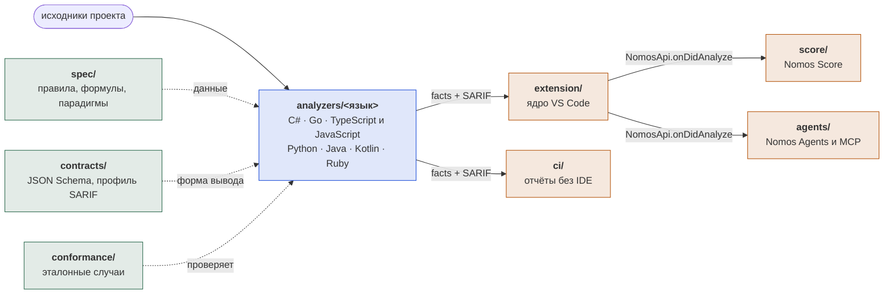

# Архитектура Nomos

[English](ARCHITECTURE.md) · **Русский**

Платформа состоит из независимых **анализаторов** (по одному на язык), общих **контрактов** и **расширения VS Code**, которое только отображает результат. Единого ядра, разбирающего все языки, нет (D-020).

Платформа даёт статистику и наблюдения для последующего анализа разработчиком. Порогов приёмки, оценок «пройдено/не пройдено» и вердиктов нет; находки — эвристики с уровнем уверенности и объяснением.

## Общая схема



Зелёное — общий закон для всех языков, синее — анализаторы, оранжевое — то, что только показывает результат. Единственные связи между частями — файлы в `contracts/` и текст в `spec/`. Расширение не знает, как устроен анализатор; анализатор не знает о расширении. Score и Agents получают результат от ядра и в анализаторы не заглядывают. О каждой части подробнее — разделы ниже: [контракты](#контракты), [правила и метрики](#правила-и-метрики), [conformance](../conformance/README.ru.md), [запуск без IDE](#запуск-без-ide), [расширение](#расширение-vs-code).

### Анализаторы

Каждый анализатор — самостоятельная программа на родных средствах своего языка.

| Язык | Папка | Разбор | Запуск | Решение |
|---|---|---|---|---|
| C# | `analyzers/csharp` | Roslyn | `src/Nomos.Analyzer.CSharp` (`nomos-csharp`) на .NET 10 | D-031 |
| Go | `analyzers/go` | `go/parser`, `go/types` | `cmd/nomos-go`, бинарник под платформу | D-038 |
| TypeScript, JavaScript | `analyzers/typescript` | TypeScript Compiler API | `src/main.ts` на Node самого VS Code; язык — `--language javascript` | D-055 |
| Python | `analyzers/python` | `ast`, `tokenize` | `main.py` интерпретатором пользователя, `python -I`, 3.10+ | D-057 |
| Java | `analyzers/java` | javac Tree API (`jdk.compiler`) | `run.mjs` на JDK 17+ пользователя | D-058 |
| Kotlin | `analyzers/kotlin` | PSI из `kotlin-compiler-embeddable` | `run.mjs` на Java 17+; компилятор закреплён в `deps.json`, загрузка — `run.mjs --fetch` | D-059 |
| Ruby | `analyzers/ruby` | Prism из стандартной библиотеки | `main.rb` интерпретатором пользователя, Ruby 3.3+ | D-061 |

Зависимостей вне стандартных средств языка нет, кроме компилятора `typescript` и компилятора Kotlin.

## Контракты

Каждый файл в `contracts/` имеет `$id` с версией и поле `x-contractVersion`. Каждый документ, выдаваемый анализатором, содержит `schemaVersion`; расширение отклоняет документы незнакомой мажорной версии с понятным сообщением.

| Контракт | Файл | Кто производит | Кто читает |
|---|---|---|---|
| Manifest | `manifest.schema.json` | анализатор, команда `manifest` | расширение, harness |
| Facts | `facts.schema.json` | анализатор, команда `analyze` | расширение (граф, метрики, дерево), harness |
| Результаты проверок | SARIF 2.1.0 + `sarif-profile.md` | анализатор, `analyze --sarif` | расширение (Diagnostics, дерево), CI, GitHub Code Scanning |
| Правило | `rule.schema.json` | авторы правил | harness, генератор документации |
| Практика | `practice.schema.json` (`spec/practices.yaml`) | авторы правил | анализаторы, расширение (через `npm run spec-json`), harness |
| Рабочая область | `nomos.schema.json` | пользователь; расширение пишет `practices` по команде и свой файл без `nomos.json` | анализаторы, расширение, CI-запуск |
| Случай conformance | `conformance-case.schema.json` | авторы случаев | harness |

Правила изменения:

- версия меняется явным увеличением `schemaVersion` и решением в `docs/decisions/`;
- добавление необязательного поля — минорная версия, всё остальное — мажорная;
- новый анализатор не меняет существующие контракты без обсуждения.

### Что в facts

Facts — измерения и наблюдения, без вердиктов:

- `files`: пути (относительно `--root`, прямые слэши), строки, `loc`;
- `modules`, `types`, `functions` со стабильными идентификаторами (родное квалифицированное имя языка) и метриками из `spec/metrics.md`;
- `dependencies`: `from`, `to`, `kind` (`import`, `inheritance`, `call`, `type-ref`), `phase` (`runtime` или `type-only`), признаки `external`/`stdlib`;
- `cycles` (Тарьян), `health` (число и вывод, без оценки);
- `paradigmEvidence` по каждому модулю;
- `skippedRules`: какое правило не применено, к какому модулю и почему;
- `diagnostics`: предупреждения и ошибки анализа.

Результаты проверок в facts не дублируются: они только в SARIF.

## Протокол запуска анализатора

Анализатор — самостоятельная программа. Расширение и CI зовут её одинаково:

| Команда | Результат |
|---|---|
| `<analyzer> manifest` | manifest в stdout |
| `<analyzer> analyze --root <путь> [--files <список>] [--sarif <файл>]` | facts в stdout; при `--sarif` результаты проверок пишутся в файл, путь отражается в `checks.sarifFile` |

`--files` — список путей относительно `--root`, разделитель — перевод строки в файле `@список.txt` либо аргументы через запятую. Если анализатор не поддерживает частичный анализ (`capabilities.partialAnalysis = false`), он игнорирует `--files` и анализирует всё; клиент это учитывает. Все текущие анализаторы работают так, и клиенты всегда анализируют весь корень: графы, Ca, Ce и циклы по части файлов неверны (D-040).

Дополнительные опции, общие для всех: `--config <nomos.json>` (файл рабочей области, `contracts/nomos.schema.json`), `--rules <список id через запятую>`. Поведение при отсутствии опций определяется manifest и значениями по умолчанию из `spec/rules`. Без `--config` анализатор обязан работать: так его запускает расширение в папке без `nomos.json`.

Вывод детерминирован: в нём нет времени, абсолютных путей, случайных идентификаторов; массивы упорядочены по Ordinal. Два запуска на одних данных побайтово равны.

### Коды возврата

| Код | Значение | Что в stdout |
|---|---|---|
| 0 | успех; число находок на код не влияет | facts |
| 1 | непредвиденная ошибка анализатора | пусто, подробности в stderr |
| 2 | ошибка использования: неизвестная команда или опция | пусто |
| 3 | входные данные не годятся: `--root` не существует, нет файлов этого языка | пусто |
| 4 | частичный результат: часть файлов не разобрана | валидный facts, файлы с `parsed: false`, причины в `diagnostics` |

Ошибки и предупреждения для человека — в stderr. Разбор stderr клиентом — только для показа; всё машинное — в stdout и в файле SARIF.

## Как расширение находит анализаторы

`nomos.json` в корне рабочей области (`contracts/nomos.schema.json`):

```json
{
  "schemaVersion": "1.0.0",
  "analyzers": [
    { "language": "csharp", "command": ["dotnet", "run", "--project", "analyzers/csharp/src/Nomos.Analyzer.CSharp", "-v", "q", "--"] }
  ]
}
```

Расширение запускает `command + ["manifest"]`, проверяет ответ по схеме и запоминает возможности. Для анализа добавляет `analyze --root ... --sarif ...`. Расширение ничего не знает о внутреннем устройстве анализатора и не содержит языко-специфичной логики.

### Без `nomos.json`: встроенные анализаторы

Опубликованное расширение несёт анализаторы с собой (D-046), в языковых пакетах (D-056, D-062). Пакет собирается под платформу (`npm run package -- --target win32-x64` в `extension/`), в папку `bundle/` кладутся сборки анализаторов и реестр `bundle/analyzers.json`:

```json
{ "analyzers": [
  { "language": "go", "files": ["**/*.go"], "command": ["${bundle}/go/nomos-go.exe"] },
  { "language": "javascript", "files": ["**/*.js", "..."], "command": ["${node}", "${bundle}/typescript/main.js", "--language", "javascript"] },
  { "language": "csharp", "files": ["**/*.cs"], "command": ["${runtime}", "${bundle}/csharp/nomos-csharp.dll"],
    "runtime": { "name": "...", "extension": "ms-dotnettools.vscode-dotnet-runtime", "command": "dotnet.acquire", "argument": { "version": "10.0" }, "resultField": "dotnetPath" } },
  { "language": "python", "files": ["**/*.py"], "command": ["${runtime}", "-I", "${bundle}/python/main.py"],
    "runtime": { "name": "...", "extension": "ms-python.python", "command": "python.interpreterPath", "argument": { "workspaceFolder": "${folder}" },
                 "path": ["python3", "python", "py"], "check": ["-I", "-c", "..."], "installUrl": "https://www.python.org/downloads/" } }
] }
```

Реестр пишет скрипт сборки; `files` он берёт из manifest анализатора (поле `files`, контракт 1.2.0). В папке без `nomos.json` расширение запускает те анализаторы, для которых нашёлся хотя бы один файл по `files`, без `--config`, с настройками по умолчанию. Настройки задаются настройками VS Code рабочей области (D-050): если задана `nomos.practices`, расширение пишет файл рабочей области с командой анализатора и `practices` в своё хранилище (`workspaces/<папка>-<язык>.json`) и передаёт его через `--config`. `ci` этих настроек не видит. Рабочая папка анализатора — хранилище расширения, поэтому SARIF не попадает в проект. `${node}` — Node.js, на котором работает само расширение: в VS Code это его исполняемый файл с `ELECTRON_RUN_AS_NODE=1`, ставить ничего не нужно (D-055). `runtime` — программа, которую выдаёт другое расширение VS Code: расширение спрашивает разрешения на его установку, вызывает `command` и берёт путь из `resultField` (без него — весь результат). Если задан `path`, расширение-поставщик необязательно и не ставится: его ответ для папки (`${folder}` в `argument`) проверяется аргументами `check`, а без него проверяются программы `path` в `PATH` по порядку; если не подошла ни одна, пользователь видит причину и ссылку `installUrl`, а анализатор пропускается (D-057). Всё это — данные реестра; код расширения языков не называет. Если `nomos.json` есть, используется только он.

## Правила и метрики

- Правила — данные в `spec/rules/*.yaml`: id, категория, описание, обоснование, парадигмы, серьёзность, порог по умолчанию. Общий список для всех языков.
- Порог — это чувствительность детектора (с какого значения о нём стоит сообщить), а не граница приёмки. Сырое значение метрики всегда присутствует в facts.
- Анализатор реализует детекторы только для правил из своего `supportedRules`. Языко-специфичные правила имеют префикс (`CS.`, `PY.`) и лежат в `spec/rules/<язык>.yaml`.
- Формулы метрик — в `spec/metrics.md`, один раз. Каждый анализатор считает их сам.
- Общие метрики сверяются `conformance/`.

### Применимость и парадигмы

Правило с парадигмой применяется только к модулям, где найден признак этой парадигмы (`spec/paradigms.md`). Остальные модули получают запись `skippedRules` с причиной `paradigm-not-detected`, а правила выключенной конфигурацией парадигмы — `disabled-by-config`. Молчаливых исключений нет.

### Практики

Практика — именованный набор правил из `spec/practices.yaml` (D-051). `practices` в `nomos.json` (контракт 1.1.0) перечисляет выбранные; правило вне них не запускается и получает запись `skippedRules` на весь запуск с причиной `disabled-by-config` и сообщением, называющим его практики. Нет поля — работают все правила. Явное `rules.<id>.enabled` сильнее практики. Практики выбирают находки, а не метрики: facts, граф и CodeLens не меняются. Незнакомый id практики — код 3.

Анализаторы и расширение получают каталог как данные: C# встраивает YAML, остальные анализаторы и расширение — JSON из `npm run spec-json` (`conformance/runner`); `npm run validate` проверяет, что JSON не устарел и что каждое правило входит хотя бы в одну практику.

## Запуск без IDE

`ci/` читает `nomos.json`, запускает каждый анализатор по протоколу и пишет в выходную папку (`.nomos`) `<язык>.facts.json`, `<язык>.sarif`, `report.md`, `report.html`. Как и расширение, он не знает языков: только контракты.

```powershell
node ci/src/cli.ts --workspace nomos.json --out .nomos --write-baseline baseline.json   # снимок
node ci/src/cli.ts --workspace nomos.json --out .nomos --baseline baseline.json         # сравнение
```

Сравнение идёт по `partialFingerprints["nomos/v1"]`, результат — `diff.json` и раздел отчёта: новые, исчезнувшие, неизменные. Код возврата: 0 — отчёты полные, в том числе при частичном результате анализатора; 1 — анализатор не завершился, отчёт это показывает; 2 — ошибка использования; 3 — нет файла рабочей области. Число находок, балл и появление новых находок на код не влияют (D-021).

## Расширение VS Code

Папка `extension/`, TypeScript. Логика чтения контрактов лежит в `src/core` и не зависит от `vscode`, интерфейс — в `src/ui`. Получает данные только из контрактов:

| Функция | Источник |
|---|---|
| Дерево проблем | SARIF, сгруппированный по модулю и категории; рядом метрики из facts |
| Diagnostics | SARIF (`message`, `region`; `level` — только при `nomos.diagnostics: level`, по умолчанию подсказки, D-054) |
| CodeLens | метрики функций и типов из facts |
| Граф | `modules`/`types`, `dependencies`, `cycles` из facts; webview: модули, типы выбранного модуля, связи типов двух модулей (D-045) |
| Признаки парадигм | `paradigmEvidence`, `activeParadigms`, `skippedRules` |
| Выбор практик | `practices.json` пакета (из `spec/practices.yaml`); выбор — в `practices` у `nomos.json` или в настройке `nomos.practices` |

Запрещено: ветвления по языку, разбор исходников, знание о Roslyn или иных парсерах. Если расширению чего-то не хватает, это расширение контракта (см. правила изменения).

## Миграция существующего .NET-кода

Миграция завершена (D-031). Прежняя реализация была построена вокруг общей модели IR и ядра с плагинами; D-020 изменило границы, а содержимое стало внутренностями анализатора C#:

| Было | Стало |
|---|---|
| `Languages.CSharp` (Roslyn → IR) | остаётся внутри `analyzers/csharp` как слой разбора |
| `Abstractions` (IR, `Queries`, `Flow`) | внутренняя модель анализатора C# |
| `Analyzers.*` (детекторы) | детекторы правил `analyzers/csharp`, привязанные к id из `spec/rules` |
| `Core` (движок, подавления, `HealthScorer`) | движок анализатора C#; поиск плагинов удалён, детекторы перечислены в `BuiltInComponents` |
| `Reporting` | удалён: json заменили facts, SARIF — `SarifProfileWriter`, md/html — `ci/` (D-039) |
| `Graph` | расчёт метрик на уровне facts (Ca, Ce, Тарьян, blast radius) |
| `Languages.TreeSitter` | удалён: общего мультиязычного разбора нет (D-017 отменён D-020) |
| `Cli` | удалён; его заменил `Nomos.Analyzer.CSharp` |

