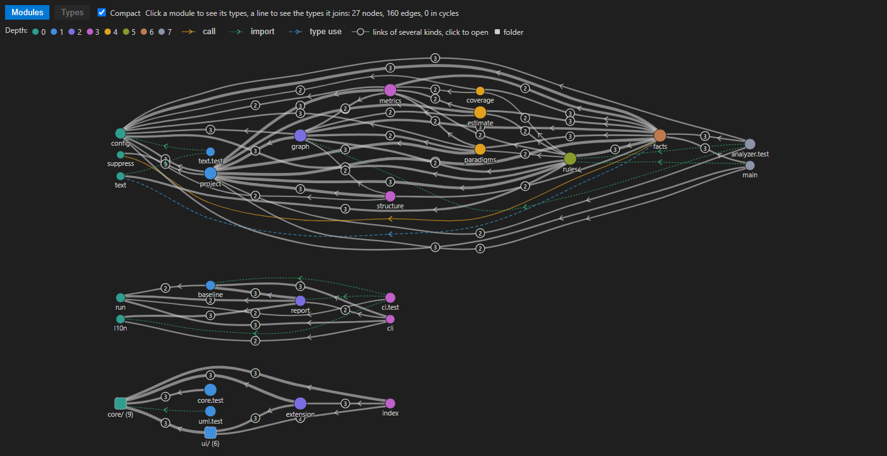
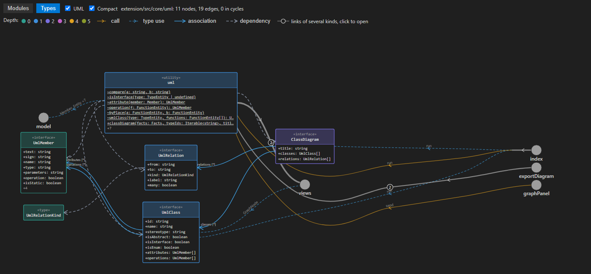

# Nomos

**Statistics and observations about your code, without verdicts.**

Nomos reads your project with each language's own tools and shows what it finds: metrics per function, type and module, a dependency graph, class diagrams, the paradigms each module uses and heuristic findings. Every finding states how confident it is and why it was raised. There are no grades to earn, no thresholds to pass and no builds to fail: the numbers are a starting point for your own reading of the code.

## Quick start

1. Install **Nomos** and the language pack for your project (or let Nomos offer it, see [Languages](#languages)).
2. Open the **Nomos** icon in the activity bar.
3. Press **Analyze** on the title of the side bar. Nothing runs before that.

No configuration is needed: without a `nomos.json`, every installed analyzer runs on the folder with its defaults.

## What you get

| | |
|---|---|
| 🔎 **Findings** | In the side bar, grouped by module, and as faint hints in the editor. `nomos.diagnostics` turns them into underlines in the Problems panel or hides them. |
| 📏 **Metrics above the code** | Size, complexity and coupling above declarations (CodeLens). |
| 🕸️ **Dependency graph** | Modules by dependency depth; click one to see its types, a line to see what it joins. Links of several kinds form bundles that open in place. |
| 🧩 **Class diagrams** | UML classes of the selected module with their members and relations, exportable. |
| 🧭 **Paradigms** | The paradigms each module uses, with evidence, and the rules skipped where a paradigm is absent, each with its reason. |

## Languages

Each analyzer comes in its own language pack, so you install only what your project uses. When the folder has files of a language whose pack is missing, Nomos offers to install it.

| Pack | Languages | Needs on your machine |
|---|---|---|
| **Nomos: C#** | C# | .NET runtime (installed for you by the .NET Install Tool) |
| **Nomos: Go** | Go | nothing: a binary for your platform |
| **Nomos: TypeScript and JavaScript** | TypeScript, JavaScript | nothing beyond VS Code |
| **Nomos: Python** | Python | Python 3.10 or newer |
| **Nomos: Java** | Java | JDK 17 or newer |
| **Nomos: Kotlin** | Kotlin | Java 17 or newer |
| **Nomos: Ruby** | Ruby | Ruby 3.3 or newer |

The status bar says when there is nothing to analyze.

## Settings

The gear on the side bar (**Nomos: Settings**) turns the metrics above the code on and off, sets how findings look in the editor and whether a save runs the analysis, and leads to the practices and to all `nomos.*` settings.

- **Analysis runs when you ask.** After the first run, Nomos analyzes again by itself only when you change the practices or the language packs. `nomos.analyzeOnSave` (off by default) runs it after each save.
- **`nomos.json`** in the folder root replaces the defaults: which analyzers run and how, rule overrides, layers, paradigms.

## More with Nomos

- **[Nomos Score](https://marketplace.visualstudio.com/items?itemName=honestarchitector.nomos-score)**: scores from 0 to 100 with what each is made of, and dashboards of the system and of each module.
- **[Nomos Agents](https://marketplace.visualstudio.com/items?itemName=honestarchitector.nomos-agents)** (preview): AI review of paradigms and practices, the speed of functions, and an MCP server over the analysis.

## Good to know

- The interface follows the language of VS Code: English or Russian.
- Findings are heuristics. Read them as observations to check, not as a quality gate.
- The analysis runs on your machine. Nomos sends nothing anywhere.

## Links

[Source code](https://github.com/NackBard/Nomos) · [Changelog](https://github.com/NackBard/Nomos/blob/main/extension/CHANGELOG.md) · [Issues](https://github.com/NackBard/Nomos/issues) · MIT License
