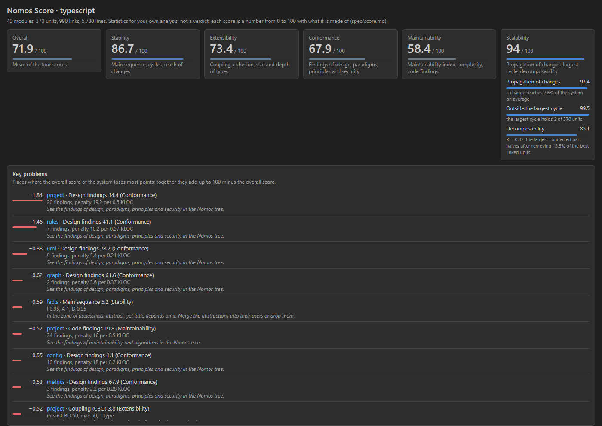
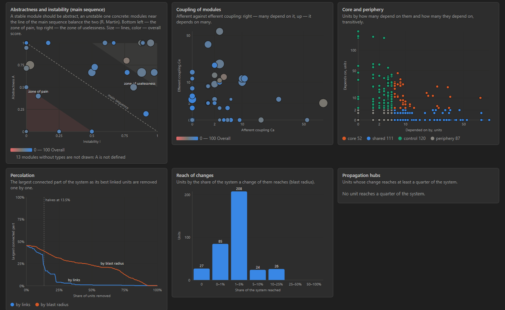
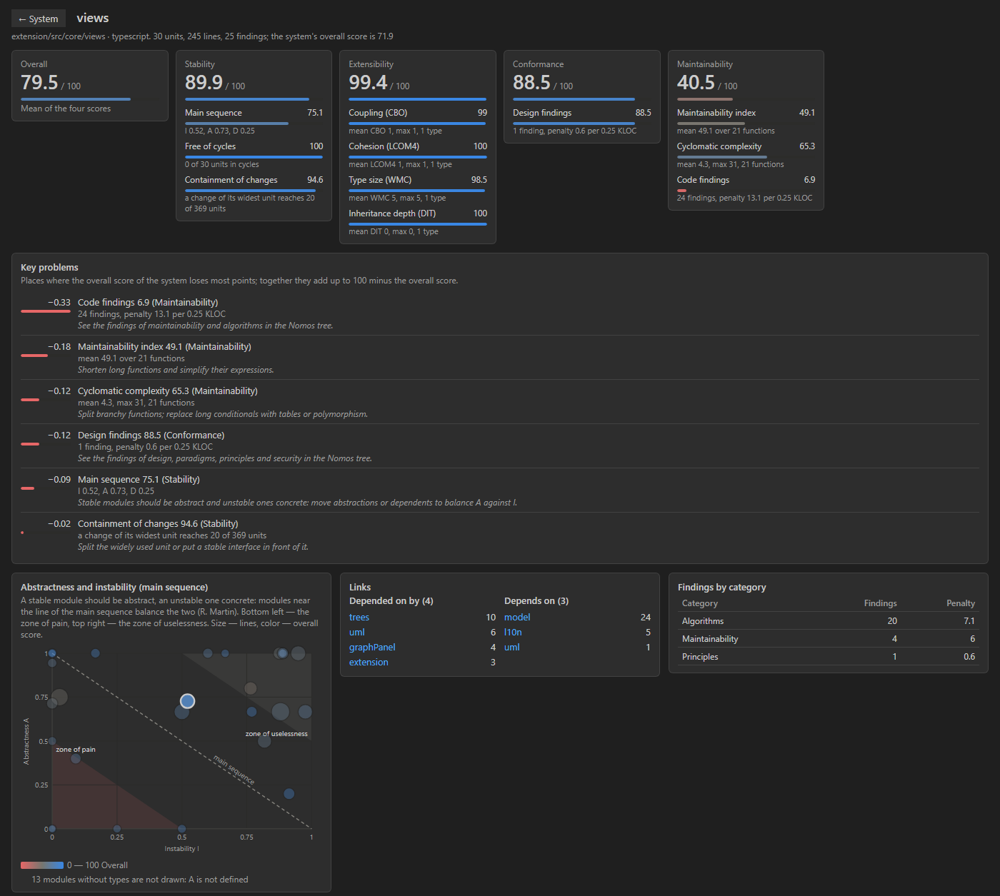

# Nomos Score

**Scores and dashboards over the Nomos analysis.**

How stable, extensible and maintainable your system is, how well it follows the practices you chose, how it scales, and where it loses most. Requires the [Nomos](https://marketplace.visualstudio.com/items?itemName=honestarchitector.nomos) extension, which does the analysis.

Each score is a number from 0 to 100 together with what it is made of. There are no grades, no pass or fail and no exit codes: the numbers point at places to look, they do not accept or reject the work. The formulas are in [`spec/score.md`](https://github.com/NackBard/Nomos/blob/main/spec/score.md).

## Opening it

| To see | Do |
|---|---|
| **The whole system** | The dashboard button on the title of the Nomos side bar, next to the dependency graph, or **Nomos: Score: System Dashboard**. **Score: Open in a Separate Window** moves it out of the main window. |
| **One module** | Double-click a module or a type on the Nomos dependency graph, click a module in the dashboard, or run **Nomos: Score: Module Dashboard** and pick one. |

With several analyzed languages, choose the analysis at the top.

## The scores

| Score | Made of |
|---|---|
| **Stability** | distance from Martin's main sequence, freedom from cycles, how far a change of the module's widest unit reaches |
| **Extensibility** | coupling (CBO), cohesion (LCOM4), size (WMC) and inheritance depth (DIT) of the types |
| **Conformance** | findings of design, paradigms, principles and security, per thousand lines |
| **Maintainability** | maintainability index and cyclomatic complexity of the functions, findings of maintainability and algorithms |
| **Overall** | the mean of the four |
| **Scalability** (system) | propagation cost of a change, the share of the largest cycle, decomposability under removal of the best linked units |

A component that is not defined for a module (a module of free functions has no abstractness, for instance) is left out and shown as not defined, never counted as zero.

## The system dashboard

- **Key problems**: the places where the system's overall score loses most points; together they add up exactly to 100 minus the overall score. Each names the module, the component, its inputs and what usually raises it.
- **Abstractness and instability (main sequence)**: R. Martin's diagram of abstractness against instability with the main sequence and the zones of pain and uselessness; size is lines, color is the overall score.
- **Coupling of modules**: afferent against efferent coupling.
- **Core and periphery**: units by how many depend on them and how many they depend on, transitively: core, shared, control and periphery.
- **Percolation**: the largest connected part of the system as its best linked units (by links and by blast radius) are removed one by one, with the share at which it halves.
- **Reach of changes**: units by the share of the system a change of them reaches.
- **Propagation hubs**: units whose change reaches at least a quarter of the system.
- **Modules**: every module with its scores and Martin's metrics; click a header to sort.

## The module dashboard

It adds the module's components, its place on the abstractness and instability diagram, its units and most complex functions, its findings by category and its links to other modules. A click on a unit or a function opens its code.

## Links

[Source code](https://github.com/NackBard/Nomos) · [Changelog](https://github.com/NackBard/Nomos/blob/main/score/CHANGELOG.md) · [Issues](https://github.com/NackBard/Nomos/issues) · MIT License
